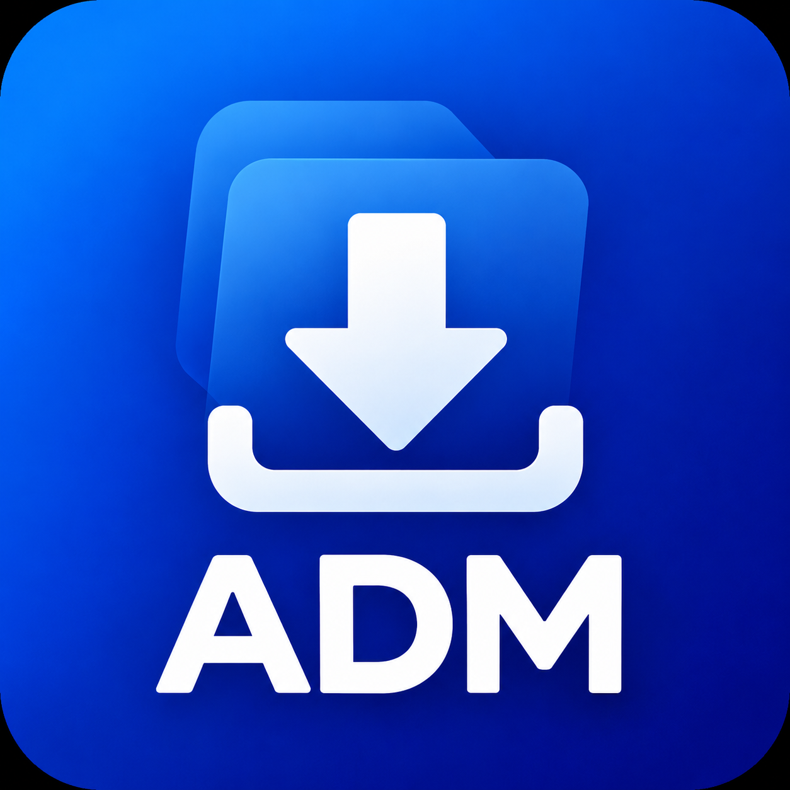

# ADM (Android Download Manager)



A lightweight download manager for Android, in the spirit of 1DM and IDM+. Written in Kotlin with Jetpack Compose (Material 3), OkHttp, Room and DataStore.

ADM is a modified version of [XDM](https://github.com/itsolaph/xdm) by olaph, released under the same GNU GPL v3 (see [License](#license)). What's different from XDM:

- **Own identity**: app name ADM, package `com.adi.adm` (installs next to XDM instead of replacing it), its own launcher icon, and finished files in `Download/ADM`.
- **HLS video with separate audio is merged automatically.** Sites that serve the picture and the sound as two playlists (common on X and other streaming sites) used to offer a "video only" quality and the audio as a separate item. ADM now downloads both and joins them into one MP4 with sound. See "Video grabber" below.

The Kotlin package is still `com.olaph.xdm`, so the code stays easy to compare with upstream XDM.


<sub>Screenshots of the original XDM (the screens are the same apart from the name). Left to right: the add sheet (size check, 8 connections), five downloads running, the built-in browser, dark theme. Files shown are public test files and Blender open movies.</sub>

## Fair use

ADM is for downloading files and videos you're **allowed** to download: your own, freely licensed (Creative Commons, public domain), or shared with the owner's permission. Don't use it to download or redistribute copyrighted content without permission.

- ADM does **not** open or get around DRM, and that won't be added. Protected streams (Widevine, FairPlay, PlayReady) are refused.
- Some services, YouTube included, forbid downloading through third-party apps in their terms of service. Following those terms and the copyright law where you live is up to you.
- This repo only contains source code. No official APKs are distributed from here.
- The software comes "as is", without any warranty (see [LICENSE](LICENSE), sections 15–16).

## Features

### Downloads
- **Multiple connections**: a file is split into 1–16 segments (8 by default) using `Range` requests and written into one temp file. Files under 1 MB use a single connection.
- **Dynamic segment splitting**: when a connection finishes its segment, it takes over half of the segment that has the most left to fetch (as long as at least 2 MB of it is left). A slow connection near the end no longer holds up the whole file, and there are never more connections than the setting allows. Only for servers with `Range` support and a known size; HLS and single-connection downloads aren't split.
- **Resume**: per-segment progress is saved to Room, split segments included, so pausing, a force-stopped app or a reboot doesn't lose work. On resume, ETag / Last-Modified / size are checked and the download restarts from zero if the file changed. Servers without `Range` support or a known size get one connection and are marked as not resumable.
- **Resume after restart** (Settings, on by default): downloads that were running or queued when the phone switched off, or when ADM was updated, go back to the queue; ones you paused stay paused, and "Wi-Fi only" still applies. Up to Android 14 they continue on their own after a reboot. Android 15 and later don't let an app start a download service at boot, so ADM posts a "downloads ready to resume" notification instead, and they continue when you tap Resume or open the app. After an app update they continue on their own on every version.
- Per-segment retries with exponential backoff for I/O errors and 5xx; 4xx fails right away (except 408/429).
- File names come from `Content-Disposition` (including RFC 5987 `filename*`), then the URL path, then the MIME type. Names are sanitized and collisions become `name (1).ext`.
- **Queue** with a parallel limit (3 by default), pause / resume / cancel / retry per item, pause all / resume all, and "Start now" to skip the limit.
- Foreground service with a summary notification plus per-download controls. It stops by itself when nothing is running.
- **Wi-Fi only** option, which waits while the network is metered.
- Finished files go to `Download/ADM/` (MediaStore on Android 10+), to a folder you choose (below), or into the private folder (below).
- **Link capture**: share a URL to ADM, use "Open with" on download-type links (apk, zip, mp4, pdf, iso, …), or accept the offer for a URL on the clipboard.
- Bulk delete per tab and a multi-select mode, optionally removing the files from storage too.
- Tapping a finished file opens it with another app ("Open with…" in the item's menu always asks which). ADM has no media player of its own.
- Finished videos show a thumbnail in the list (a frame picked once and cached as a small JPEG in the app's cache).

### Staying alive in the background
- **Android 15's time limit.** A download service of the `dataSync` kind may run about **6 hours in any 24** while the app is in the background; when the budget is used up Android calls the service's `onTimeout` and expects it to stop within seconds. ADM then pauses every running and waiting download (progress is saved, nothing fails), stops the service and posts "Android paused N downloads (background time limit)" with a **Resume** button. Opening ADM starts the clock over and also resumes those downloads by itself; ones you paused yourself stay paused. ADM can't get around this limit: a long queue that needs more than 6 hours in the background will stop and wait for you. It only applies to apps that target Android 15, which ADM does, on devices that run it. If the system refuses to start the service (limit used up, start from the background), ADM posts the same kind of notification instead of crashing.
- **Battery optimisation.** Many phones (Xiaomi, Samsung, Oppo and others) stop apps that are under battery optimisation. Once you have started a download above 200 MB, or have more than 3 downloads running or queued, a card on the Downloads screen offers to exempt ADM (it can be dismissed). Settings → Background shows the state and opens the system screen; "Background tips" opens the Autostart list on Xiaomi / Redmi / POCO phones and the app's info page elsewhere. The permission for the direct request (`REQUEST_IGNORE_BATTERY_OPTIMIZATIONS`) is declared because ADM isn't distributed on Google Play, which restricts it.
- **Network changes.** When the default network changes (Wi-Fi to mobile data or back) or drops, the connections of running downloads are aborted at once instead of hanging until the TCP timeout. The segments pick up from their saved offsets; before they do, the file on the server is compared again (size, ETag, Last-Modified), and a file that changed in the meantime is downloaded from zero rather than stitched together. Retries wait while there is no network and don't use up their attempts. With "Wi-Fi only" on, a switch to mobile data parks the downloads as "Waiting for Wi-Fi" and they continue when Wi-Fi is back.

### Save location
- Settings → **Save location**: the default is `Download/ADM` through MediaStore. "Choose folder…" opens the system folder picker (internal storage, an SD card or any storage provider), keeps the access across restarts and shows the folder's name; "Reset to Download/ADM" goes back.
- **Sort into subfolders by type** (off by default): Video, Audio, Images, Documents, Archives, Apps, Other, decided by the file extension and then the MIME type. Works in `Download/ADM/<Type>` and inside a chosen folder.
- If the chosen folder is gone (deleted, card removed, access revoked), the finished file is saved to `Download/ADM` instead, the item says "Saved to Download/ADM: chosen folder unavailable", and the Downloads screen shows a warning until you dismiss it. A file that can't be saved at all is kept, and Retry saves it again.
- Free space is checked before a download starts, where the partial file lives, and, for a chosen folder on internal storage or an SD card, on that volume too (other storage providers can't be asked, so that check is skipped). ADM doesn't try to warn about FAT32's 4 GiB limit: the file system can't be told reliably.
- The private folder isn't affected.

### Schedule and speed limit
- **Schedule** (Settings, off by default): a daily window with a start and end time, which may cross midnight (equal times mean always), and optionally "Only while charging". Outside it queued downloads show as **Scheduled** with the start time, and running ones go back to the queue when the window closes. "Start now" on a download ignores the schedule for that download; "Wi-Fi only" still applies to everything. The service doesn't stay up while only waiting for the window.
- **Waking up.** At the window start an exact alarm (the one wake-up Android lets start a foreground service from the background) starts the service. Android 13+ needs the "Alarms & reminders" access for exact alarms; Settings → Schedule links to it. Without it, or when the system refuses the start anyway, ADM posts "Scheduled downloads are ready" with a Resume button. Plugging in the charger is only noticed while ADM's process is alive, and then does the same. The alarm is set again after a reboot, an app update, and a change of time or time zone.
- **Speed limit** (Settings, Off by default): one cap in KB/s or MB/s for everything ADM downloads together, every connection of every kind (plain files, HLS, YouTube). It applies to downloads that are already running, without restarting them. The Downloads screen shows the active limit and the next start time.

### Duplicate warning
- Before a download is added (browser capture, share or "Open with", pasted URL, YouTube video or playlist), ADM checks the list. It's a duplicate if the **link** is the same, if the **file name** is the same in the folder the file would be saved to (unfinished downloads count as being in that folder), or if the **size** is known and the same with the same name apart from a " (2)" and the same extension. Cancelled downloads are ignored, and a finished download only counts while its file is still there. Private downloads are never compared and never shown, so the dialog can't reveal what the private folder holds.
- A match shows "This file may already be in your list" with the item's name, status and progress. **Resume existing** is the main button for a paused or failed match, otherwise **Open existing**; **Download again** adds it anyway (with a unique name, like any other download), **Cancel** backs out. No match, no dialog.
- A YouTube playlist gets one summary instead ("2 of 5 already in your list") with **Skip duplicates** (the main button) or **Add all**. Links are compared as they are (signed query strings included), so a re-signed link of the same file is caught by name or size instead.

### Expired links
- ADM remembers the page a download came from (the browser tab, or the Referer header; older downloads fall back to the Referer they were started with).
- **Automatic refresh** (Settings → "Refresh expired links automatically", on by default): when a plain download fails with HTTP 403/410 and ADM knows its page and its size, ADM loads that page itself in a hidden WebView (the browser's cookies, `<video>` elements started muted, every requested file checked, ad blocking as in the browser). The first file whose size is exactly the download's size becomes the new link and the download goes on from the bytes already saved, with a quiet "Link refreshed, download resumed" notification. One refresh runs at a time (others wait), each gets 60 seconds, and a download gets at most 2 automatic attempts in 30 minutes. Only while ADM's process is alive; the foreground service is kept up while a refresh runs. If no WebView can be created, nothing happens and the ordinary failure notification stays. If the page times out or shows no file of that size, the download stays failed and the notification "Couldn't refresh the link for …" has **Open page**, which starts the visible flow below. A different size is never applied by itself. Not for private downloads, HLS or YouTube.
- By hand: the round button on a failed row becomes **Refresh link** ("Retry with the same link" moves to the menu), and the notification and the details screen offer it too, as does the item's menu on a failed or paused download. With the automatic setting off, it always takes a tap.
- Refresh opens that page in the built-in browser with a banner. While it is open, every file the page requests (including from iframes) is checked in the background, and the page's `<video>` elements are started muted a few times. The first file whose size is exactly the download's size becomes its new link without a question, the browser closes that tab and the download goes on from the bytes already saved. A name or extension alone never counts. Some players in other domains still wait for a tap: the banner says so.
- If nothing matches within 45 seconds the browser stays in refresh mode, and the usual way works: start the same download again or pick a video from the browser's video button, and ADM asks about it.
- A link is accepted only for the same file: its size must match, and if the old download had an ETag and the new one differs, ADM warns and offers "Restart from zero" instead of keeping the progress (this also applies to an automatic match, which then asks first). On a match the link and the cookies/User-Agent/Referer of the new capture are swapped in, and the download goes on with the segments it has. Downloads with an unknown size can't be matched automatically.
- **Change URL…** in the item's menu does the same with a link you paste. Not for YouTube (it looks its links up again by itself) and not for HLS.

### Private folder
- A locked folder for downloads you don't want in the gallery. The lock icon in the Downloads screen opens it.
- A 4–8 digit PIN, set on first use. Only a salted PBKDF2-HMAC-SHA256 hash (150,000 rounds) is stored, never the PIN. After 5 wrong PINs there's a 30 s pause, which doubles with every further wrong PIN (up to an hour). Fingerprint or face unlock can be switched on in the folder's menu; the PIN always works too. "Change PIN" needs the old one.
- Locks itself when ADM goes to the background (immediately, after 1 minute or after 5 minutes; Settings) and whenever the screen turns off.
- **Forgotten PIN**: there is no recovery. "Reset private folder" (on the PIN screen) deletes every private file, private downloads still in progress, and the PIN, after you type `RESET`.
- "Save to private folder" in the add sheet, the browser's video sheet and the YouTube sheet (default: Settings → "Save new downloads to private folder"). Private downloads run like any other; when they finish, the file moves into the private folder instead of `Download/ADM`.
- Finished public downloads can be moved in ("Move to private folder" in the item's menu): the file is copied, the size is checked, then the public copy is deleted (through the system's confirmation dialog if ADM didn't create it). If the copy fails, nothing changes; if the public copy can't be deleted, both stay and ADM tells you.
- Inside: thumbnails, size and duration; tap to open with another app (after a warning); Move out (back to `Download/ADM`), Rename, Share (with a warning that the copy leaves the folder), Delete, multi-select and "Delete all".
- Private items never appear in the main Downloads list, locked or not; they only show inside the private folder (unfinished ones too, with pause/resume/cancel). The main list's "Delete all" and multi-select can't reach them.
- Notifications for private downloads say "Private download" without file name, error text or preview, are hidden on the lock screen, and open the private folder (which asks for the PIN), never the file.
- Screenshots, screen recording and the recents thumbnail are blocked while the private folder is on screen.

**How private is it?** The files live in ADM's app-internal storage (`files/private/`). Android's app sandbox keeps other apps, file managers, the gallery and MediaStore out, and the device's file-based encryption protects them while the phone is locked. There is **no extra encryption by ADM**: anyone with root access to the phone (or a tool that copies app data with root) can read the files. The PIN only guards ADM's own screens. The folder and the PIN are excluded from cloud backups and device-to-device transfers. While a private download is still running, its partial data is in ADM's temporary folder (app-specific storage, not indexed by the gallery); it only moves into the private folder when it's finished. Thumbnails of private videos are kept in ADM's internal cache and deleted with the item or by a reset. Uninstalling ADM deletes the private folder.

### Built-in browser
- Tabs, incognito tabs, bookmarks, history, a speed-dial home page, desktop mode, find in page, and WebView dark mode where supported.
- Downloads started in the browser open ADM's "Add download" sheet instead of the system downloader. The page's cookie, User-Agent and Referer are carried along and kept across pause/resume and app restarts.
- Long-press a link, image or video for "Download with ADM", "Open in new tab", "Copy link" and "Share link".
- **Fullscreen video**: a video's fullscreen button fills the screen, hides the system bars, keeps the screen on and allows landscape. Rotating doesn't reload the page. Back, switching tabs or leaving the browser ends it.

### Video grabber
- Each tab watches network requests and the page DOM (`<video>`, `<source>`, `og:video`, `MutationObserver`, `play` events) for media: mp4, webm, mkv, mp3, m4a, m3u8, mpd and so on. Candidates are checked in the background to confirm type and size.
- A floating button shows what was found: type, quality, size (estimated for HLS), and the item that's currently playing at the top. HLS master playlists list every variant and separate audio tracks.
- **Separate audio, merged automatically**: when a quality keeps its sound in another playlist (its `AUDIO` group in the master playlist), it's listed as "video + audio". Choosing it downloads the video, then the audio (the `DEFAULT=YES` track of that group, otherwise the first), and copies both into one MP4 without re-encoding. MPEG-TS, fMP4 and packed AAC/MP3 audio are supported; video and audio on the same clock keep their exact offset, packed audio is lined up at the start. Pause and resume work per part. If the two can't be merged, the video is kept on its own with the note "Saved without sound (…)". A quality whose group has no playlist of its own stays "video only", and the audio tracks are still offered separately too.
- **HLS downloads** (VOD): master and media playlists, `BYTERANGE`, `MAP`, AES-128 keys, segments downloaded in parallel and resumable per segment.
- **HLS to MP4**: MPEG-TS output is copied into a real MP4 without re-encoding (H.264/H.265 + AAC or MP3) using `androidx.media3`, so it plays and seeks in any gallery app. Timestamp jumps and discontinuities are stitched into one timeline. If conversion fails, the `.ts` is kept with a note.

### YouTube
- Uses [NewPipeExtractor](https://github.com/TeamNewPipe/NewPipeExtractor), no yt-dlp or Python. The version is one line in `gradle/libs.versions.toml` (`newpipeExtractor`); when YouTube changes something, bump it.
- Works from the share sheet, the "Add download" field, the clipboard offer and the built-in browser. Accepts `watch`, `youtu.be`, `shorts`, `embed`, `live` replays, `music.youtube.com` and playlists (up to 200 videos).
- Choose a resolution (DASH video + best AAC audio, merged into one MP4 without re-encoding), a quick 360p single file, or audio only (M4A). A default quality can be set in Settings.
- Stream URLs aren't stored, only the video id and format. Expired URLs (403/410) are refreshed and the download carries on from the bytes already on disk.
- Errors are explained in plain words: age-restricted, private, removed, members-only, live, region-blocked, bot check, or "YouTube changed something; ADM needs an update."

### Ad blocking
- A pure Kotlin filter engine for a subset of EasyList / AdGuard / uBlock Origin syntax: network rules with the common options (`third-party`, `domain=`, resource types, `important`, `badfilter`, `@@` exceptions, page-level exceptions) and cosmetic rules, both site-specific and generic.
- Bundled lists: EasyList, AdGuard Base, AdGuard DNS filter and StevenBlack hosts, each switchable in Settings and updatable from inside the app. Third-party checks use the bundled Public Suffix List.
- Pop-up blocking (off / ads only / all) and protection against redirect click-jacking.
- A shield icon shows how much was blocked on the page, with a per-site allowlist.
- Blocking runs before the video grabber, so ad streams never show up in the video list. Downloads you start yourself are never blocked.

## Building

You need JDK 17 and the Android SDK (platform 35, build-tools 35.0.0). Create `local.properties`:

```
sdk.dir=/path/to/android-sdk
```

Then:

```
./gradlew testDebugUnitTest assembleDebug
```

The APK ends up in `app/build/outputs/apk/debug/app-debug.apk`. To install it, allow "Install unknown apps" for whatever app opens the file. On Android 13+, allow notifications when asked.

Builds are signed with the default Android debug key, which differs per machine, so an APK built elsewhere can't update one that's already installed. Use your own keystore through `private.properties` (below) if you want a stable signature.

### Optional build config

Everything here is optional; the build works without it. Put the keys in `private.properties` at the repo root (gitignored, as is `private/`) or pass them as `-Pxdm.<key>=…`. `-P` wins if both are set.

| Key | What it does |
|---|---|
| `crashRelayUrl` | Endpoint for crash reports. Empty means crash reporting is off: nothing is written or sent. |
| `crashRelayKey` | Value of the `X-App-Key` header for that endpoint. |
| `signingStoreFile` | Keystore for signing debug and release builds (relative to the repo root, or absolute). Empty means the default debug key. |
| `signingStorePassword` | Keystore password. |
| `signingKeyAlias` | Key alias. |
| `signingKeyPassword` | Key password. |
| `privateRulesFile` | Extra filter rules (EasyList syntax), copied into the `xdm-private.txt` asset and merged into the `xdm-extra` list. |

## Project layout

- `engine/`: the download core, plain Kotlin/JVM with no Android APIs. Probing, segment splitting, the multi-connection engine, the shared speed limiter, the M3U8 parser and the HLS engine. Tested against `MockWebServer`.
- `media/`: video detection (URL classification, per-tab collection, probing, HLS quality options).
- `adblock/` and `adblock/filters/`: the filter engine, list loading, binary cache and updates.
- `remux/`: MPEG-TS to MP4, and the merger that joins separate video and audio (YouTube DASH, HLS renditions) into one MP4.
- `youtube/`: link parsing, format selection, error messages, the NewPipeExtractor bridge.
- `core/`: `DownloadManager` (queue, pause/resume, Wi-Fi only, schedule, Android's time limit, link replacement, moves into and out of the private folder), `RunGate` (may this download run now?), storage (`FileSaver`: MediaStore and chosen folders), network and charger monitors.
- `vault/`: the private folder's storage, PIN hashing, wrong-PIN cooldown and the lock state machine.
- `data/`: Room and DataStore.
- `service/`: foreground service and notifications.
- `browser/`: tabs, WebView, download capture, the injected scripts.
- `ui/`: Compose screens.

Room schemas are exported to `app/schemas/` and committed. `MigrationTest` runs every migration on a populated database and compares the result with the exported schema. There are no destructive migrations.

CI runs the unit tests, a build and lint, then a smoke test on an emulator. That includes a real YouTube download of *Big Buck Bunny*, which may come back BLOCKED when YouTube rejects the runner's IP, and the private folder self-test: debug builds contain `VaultTestActivity` (`adb shell am start -n com.adi.adm/com.olaph.xdm.debug.VaultTestActivity`), which puts a bundled 10 s test video into the private folder, checks MediaStore can't see it, reads its duration and decodes a frame with `MediaMetadataRetriever`, deletes it again and logs one `VAULTTEST PASS …` or `VAULTTEST FAIL …` line. A second self-test, `SaveTestActivity`, saves a small file with "sort by type" on, checks it lands in `Download/ADM/Video`, reads it back byte for byte and deletes it, runs the schedule decision, holds the speed limiter to 256 KB/s for 2 seconds, and logs one `SAVETEST PASS …` or `SAVETEST FAIL …` line (log tag `XDM`, kept from upstream).

## Known limitations

- Moving a finished file into `Download/ADM` or a chosen folder copies it, so it briefly needs about twice the space.
- On Android 15+, downloads interrupted by a reboot wait for a tap on the notification (or for the app to be opened); see "Resume after restart".
- On Android 15+, the background time limit (about 6 hours in 24) pauses downloads that need longer; see "Staying alive in the background". ADM doesn't use the user-initiated data transfer jobs that Android offers for long transfers.
- A schedule wake-up can start downloads from the background only with the exact-alarm access (Android 13+) or when ADM is exempt from battery optimisation; otherwise a notification asks for a tap. The charger is only noticed while ADM is running.
- Refreshing an expired link needs the page it came from (or a Referer), which shares and clipboard links don't have (use "Change URL…" then). Automatic matching, in the background or in the browser, needs a known file size, and pages whose player needs a login, a captcha or a tap in another domain still need your help. The background refresh can't run when Android won't let the process stay up or provides no WebView.
- The duplicate check compares links as written, so a link that is re-signed on every visit is only caught by its name or size. A page that signs links per visit may offer a file with another ETag, which means starting over.
- **Video**: no DRM (by design). Live HLS isn't downloaded. DASH (`.mpd`) outside YouTube is detected but not downloadable yet. `blob:` players only work when the real manifest shows up in network traffic. HLS to MP4 supports H.264/H.265 with AAC/MP3; other codecs keep the `.ts`. Detection is heuristic, so false hits and misses happen.
- **YouTube**: depends on NewPipeExtractor keeping up with YouTube. No account login, so age-restricted, members-only, paid and private videos can't be downloaded. Live streams, premieres and channels aren't supported. Video comes as H.264 up to 1080p, or AV1 above that; VP9/WebM isn't offered because media3's MP4 muxer rejects it. Audio is always AAC. No subtitles or chapters. Datacenter and VPN IPs often hit the bot check.
- **Ad blocking**: scriptlets (`+js()`), procedural selectors, `$replace`, `csp`, `removeparam` and similar rules aren't supported and are skipped. Sites that need scriptlets, YouTube's video ads among them, still show ads. `redirect=` blocks instead of serving a stub. Request types are inferred because WebView doesn't report them. Lists use about 27 MB of heap, and the first compile after an install or update takes a few seconds.
- Saved cookies aren't refreshed on their own. When a session or link expires, "Refresh link" (or "Change URL…") captures new ones from the browser.
- **Private folder**: see "How private is it?" above. A move into the folder needs free space for a second copy for a moment. Opening a private file in another app or sharing one lets that app read it (and possibly keep a copy).
- Browser: `blob:`/`data:` downloads can't be captured, tabs aren't restored after the process is killed, location and camera are always denied.

## License

ADM is a modified version of XDM (Copyright © olaph, https://github.com/itsolaph/xdm) and, like XDM, is released under the **GNU GPL v3.0 or later** (see [LICENSE](LICENSE)), since it uses NewPipeExtractor, which is GPL as well. The changes from XDM are listed at the top of this file; the full history is in git. If you distribute an APK of ADM, the GPL requires you to offer the matching source code too.

## Credits

ADM is built on **[XDM](https://github.com/itsolaph/xdm) by olaph**: the download engine, HLS, YouTube support, browser, ad blocking and private folder all come from there.

Libraries, all pulled unmodified from Maven Central / JitPack:

| Library | Source | License |
|---|---|---|
| NewPipeExtractor | https://github.com/TeamNewPipe/NewPipeExtractor | GPL-3.0-or-later |
| NewPipeExtractor dependencies: nanojson, jsoup, protobuf-javalite, Rhino | via NewPipeExtractor | nanojson's own license, MIT, BSD-3-Clause, MPL-2.0 |
| OkHttp / Okio | https://github.com/square/okhttp | Apache-2.0 |
| AndroidX: Jetpack Compose, Material 3, Room, DataStore, WebKit, Lifecycle (incl. lifecycle-process), Fragment, Biometric | https://developer.android.com/jetpack/androidx | Apache-2.0 |
| AndroidX Media3 (extractor, muxer) | https://github.com/androidx/media | Apache-2.0 |
| Kotlin, kotlinx.coroutines | https://github.com/JetBrains/kotlin, https://github.com/Kotlin/kotlinx.coroutines | Apache-2.0 |
| desugar_jdk_libs | https://github.com/google/desugar_jdk_libs | GPL-2.0 with Classpath Exception |

Tests use JUnit 4 (EPL-1.0), Robolectric (MIT), MockWebServer (Apache-2.0) and sqlite-jdbc (Apache-2.0). The YouTube test video is *Big Buck Bunny* (© Blender Foundation, CC BY 3.0). The private folder self-test video (debug builds only) is a synthetic test pattern and tone generated with FFmpeg.

The bundled filter lists are separate works under their own licenses. They're only trimmed (comments and rule types ADM can't use are removed), never edited. Full license texts are in `app/src/main/assets/licenses/` and readable in the app under Settings → "About & licenses".

| List | Source | License | Snapshot |
|---|---|---|---|
| EasyList | https://easylist.to/easylist/easylist.txt | GPLv3 / CC BY-SA 3.0 (dual) | 09 Oct 2026 18:18 UTC |
| AdGuard Base (without EasyList, uBO variant) | https://filters.adtidy.org/extension/ublock/filters/2_without_easylist.txt | GPLv3 | 2026-10-09T17:05:11Z |
| AdGuard DNS filter (domain rules only) | https://adguardteam.github.io/AdGuardSDNSFilter/Filters/filter.txt | GPLv3 | 2026-10-09T18:18:53Z |
| StevenBlack/hosts (unified) | https://github.com/StevenBlack/hosts | MIT (© Steven Black) | 2026-10-07 |
| Public Suffix List | https://publicsuffix.org/list/public_suffix_list.dat | MPL-2.0 | 2026-10-10 |

`licenses/filter-lists-NOTICE.txt` summarizes sources, licenses and dates. The built-in `xdm-extra.txt` list comes from XDM.
